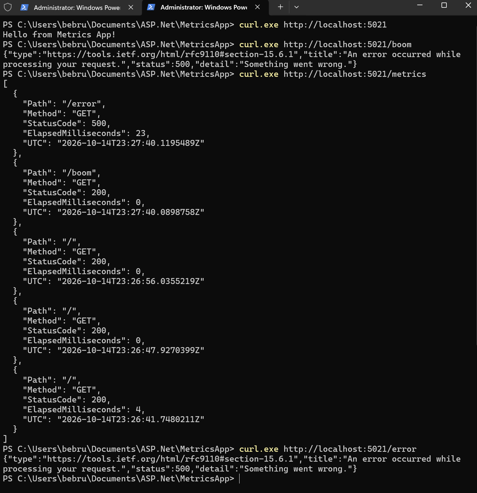

# MetricsApp

## Custom Middleware & Error Handling

This ASP.NET Core project demonstrates custom middleware for measuring request execution time and global exception handling.

## Features

- Custom `RequestTimingMiddleware`
- Uses a stopwatch to measure request duration
- Stores the last 20 request metrics
- `GET /metrics` returns request history as JSON
- Global exception handling with `UseExceptionHandler`
- `/error` returns an HTTP 500 Problem response

## Sample `/metrics` Output

```json
[
  {
    "Path": "/error",
    "Method": "GET",
    "StatusCode": 500,
    "ElapsedMilliseconds": 23,
    "UTC": "2026-10-14T23:27:40.1195489Z"
  },
  {
    "Path": "/boom",
    "Method": "GET",
    "StatusCode": 200,
    "ElapsedMilliseconds": 0,
    "UTC": "2026-10-14T23:27:40.0898758Z"
  }
]
```

## Screenshots

